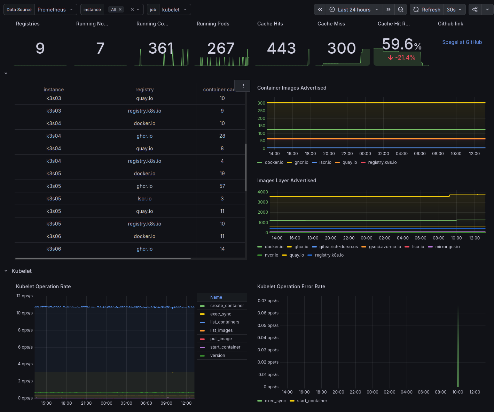

# Spegel (K3s Embedded Registry Mirror) Dashboard

Dashboard for the Spegel peer-to-peer registry mirror embedded in K3s.

Spegel <https://github.com/spegel-org/spegel> runs on every node as a local, pull-only OCI registry. Containerd uses it as a mirror, so an image layer already on one node can be served to other nodes from inside the cluster instead of being pulled again from the upstream registry.

This dashboard is based on [dashboard 18089](https://grafana.com/grafana/dashboards/18089) by Leven-Lake. It has been updated for the metric names used by current Spegel releases bundled with K3s, where the original dashboard's image and layer panels show "No data".

Available on [Grafana](https://grafana.com/grafana/dashboards/25919/) as ID: `25919`

## Requirements

* K3s with the embedded registry mirror enabled (`embedded-registry: true` in the K3s server config, plus mirror entries in `registries.yaml`)
* Prometheus or a compatible TSDB (VictoriaMetrics works) scraping the K3s node metrics endpoint. In K3s, Spegel metrics are exposed alongside the kubelet metrics.
* kube-state-metrics, for the pod and container count panels

## Metrics Used

| Metric | Purpose |
|:---|:---|
| `spegel_advertised_image_digests` | Images each node advertises to peers, by registry |
| `spegel_advertised_content_digests` | Content (layer/blob) digests each node advertises, by registry |
| `spegel_mirror_requests_total` | Mirror requests served, split by `cache="hit"` / `cache="miss"` |
| `kubelet_runtime_operations_total` / `_errors_total` | Container runtime operation and error rates |

These replace `spegel_advertised_images` and `spegel_advertised_keys`, which older Spegel versions used.

## Panels

* **Overview:** number of registries, running nodes, pods and containers, cache hits, cache misses, cache hit ratio
* **Advertised content:** per-node table of advertised images and layers, plus images and layers advertised per registry over time
* **Kubelet:** runtime operation rate and error rate (pull_image, create_container, list_images, ...)

## Variables

* **Data Source:** your Prometheus-compatible data source
* **job:** defaults to `kubelet`. On K3s server nodes the same Spegel metrics can also be scraped by an `apiserver` job, which would count control-plane nodes twice. Keep `kubelet` selected unless your scrape config differs.
* **instance:** filter to one or more nodes

## Notes

* If the dashboard opens with `job=All`, check whether the URL contains `var-job=All`, for example from an old bookmark.

[Back to Dashboard List](../README.md)
